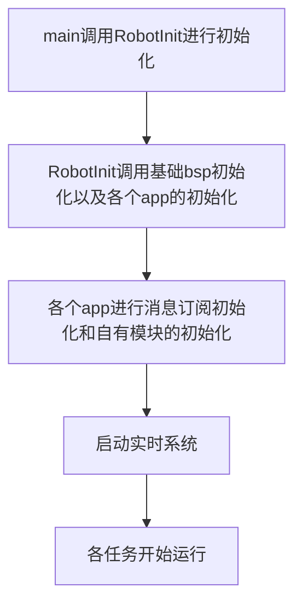
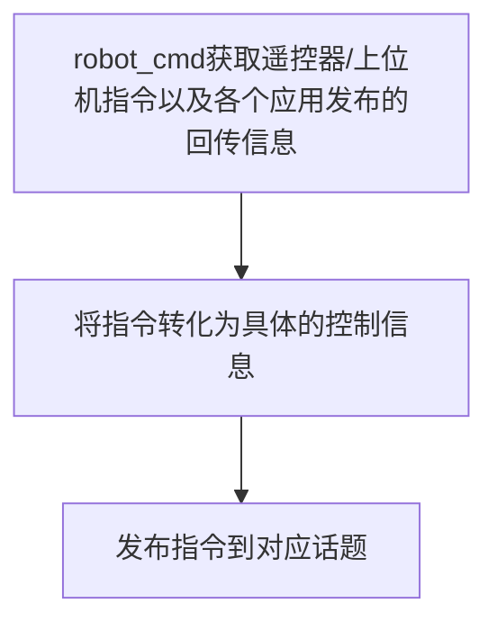

# application

<p align='right'>neozng1@hnu.edu.cn</p>

这是application层的说明。

> todo: 是否有必要将所有电机等模块的初始化参数放到一个头文件？

## 使用说明

在main函数中包含`robot.h`头文件，这是对整车的抽象。将`INStask`，`motortask`，`ledtask`，`monitortask`这四个task加入`freertos.c`中，创建对应的任务，设置合适的任务运行间隔；然后将`robottask`放入freertos.c中，同样以一定的频率运行。 在初始化实时系统之前，在`main()`中调用`RobotInit()`进行整车的初始化。

**关于运行的任务**，INStask的运行频率必须为1kHz，motortask推荐的运行频率为200Hz\~1000Hz（详情见module/motor/motor_task.c），在MotorTask内部，对于高实时性要求的电机可以提升到1kHz，不过要注意CAN总线的负载。monitortask的运行频率为100Hz；robottask的运行频率推荐为150Hz以上，应当高于视觉发送的频率，若后续使用插帧，同样应该保证不低过motortask太多。

若使用双板，则在`robot_def.h`中给对应的开发板设定宏定义，如底盘板使用`#define CHASSIS_BOARD`，云台板使用`#define GIMBAL_BOARD`；单个开发板控制整车，则定义`#define ONE_BOARD`。在每个应用中，都已经使用编译预处理指令完成条件编译，会自动根据设定的宏切换功能。使用双板的时候，目前板间通信通过CAN完成，因此两个开发板会挂载在一条总线上，在两个开发板对这条总线的其他使用CAN的设备进行配置时注意**不要发生ID冲突**，还要注意**防止负载过大**。

**同样，在该文件中你需要修改一些关于机器人的参数**。比如底盘和云台对齐时yaw电机编码器的值，拨盘的单圈载弹量、底盘的轴距等等。


## 共用应用故障状态

`daemon.h` 定义 `App_Fault_s` 及四类故障位，供 CMD、底盘、云台和发射共用；`robot_def.h` 包含该头文件，并在底盘、云台和发射的上传结构中使用 `App_Fault_s fault`，各自保存和更新自己的状态：

```c
typedef struct
{
    uint8_t motor_offline_flags; // 本应用电机 1～8 的离线位，使用 Motor_Offline_Flag_e
    uint8_t comm_fault_flags;    // 命令/应用反馈链路故障，使用 App_Comm_Fault_Flag_e
    uint8_t imu_fault_flags;     // IMU 离线或数据无效，使用 App_IMU_Fault_Flag_e
    uint8_t control_fault_flags; // 遥控器/图传控制输入离线，使用 App_Control_Fault_Flag_e
} App_Fault_s;
```

公共定义不规定电机属于什么机构。底盘在 `chassis.c` 中把电机 1～4 对应轮向、5～8 对应舵向；云台后续可把 1～2 对应 yaw、pitch，发射可把 1～3 对应左右摩擦轮和拨弹电机。未使用的位保持为 0，其他应用接收状态后按对应应用的映射解释。例如同一个 `MOTOR_1_OFFLINE` 在底盘和云台中可分别表示左前轮向和 yaw 离线，各份状态互不影响。

该结构固定为 4 字节，各字段独立按位组合，不再保存重复的应用汇总故障位。通信字段描述本应用依赖的命令或其他应用反馈链路，以及收到的应用命令内容无效，不绑定 CAN、串口或消息中心；电机反馈不可用记录在电机离线位中。IMU 字段区分离线和数据无效；控制输入字段区分遥控器和图传。未使用、未接入检测的字段及位保持为 0，不能据此认定设备已确认正常。

每个应用按本周期检测结果覆盖已接入的字段，使用 `MotorIsOffline(daemon, can)` 检查自己的电机并组合离线位。命令链路不可用时填写 `APP_COMM_FAULT_COMMAND_OFFLINE`，命令内容无效时填写 `APP_COMM_FAULT_INVALID_COMMAND`，恢复后清除。当前底盘和本工程的发射应用已接入电机和命令通信反馈；IMU、控制输入检测以及独立云台工程的接入仍待完成。

`daemon.h` 声明共用函数 `AppFaultUpdate(daemon, &fault)`，实现在 `daemon.c` 中，底盘和本工程的发射应用复用该函数。它将四个分类字段按电机、通信、IMU、控制输入的顺序存入 daemon 的 32 位快照并返回该值，最低字节为电机位；返回 0 表示无故障。同时，电机、IMU 或依赖的应用反馈链路故障会使 daemon 的设备反馈有效状态为 0，命令链路及控制输入故障只记录到快照，不使设备反馈失效。状态采集、命令校验、超时喂狗和停机策略仍由所属应用负责。

## 封装总览

Robot.c是整个机器人的抽象，其下有4个应用：robot_cmd，gimbal，chassis，shoot。此框架当前是针对步兵/英雄/哨兵设计的，其他机器人只需要根据各自的特殊机构进行修改即可。robot_cmd是整个机器人的核心应用，其负责接受遥控器/上位机发来的指令，并将指令转化为实际的运动控制目标，发送给其他三个应用。后者会根据robot_cmd发来的命令，设定电机和其他执行单元的参考值等。

为了进一步解耦应用之间的关系，app层并没有module和bsp之间的那种层级结构（或设计模式中所谓的**结构类型模式**，即robot_cmd包含其他三个模块），而采用了应用并列的**发布-订阅**机制，四个应用之间没有任何相互包含关系，他们之间的通信通过module层提供的`message_center`实现。每个应用会通过该模块向一些话题（事件）发布一些消息，同时从一些话题订阅消息。如robot_cmd应用会发布其他三个模块的控制信息，同时订阅其他三个模块的反馈信息。其他三个模块会订阅robot_cmd发布的控制信息，同时发布反馈给robot_cmd的信息，他们不需要知道彼此的存在，只是从`message_center`处获取其他应用发布的消息或向自己发布的话题推送消息。

application在初始化module的时候，初始化参数会包含部分bsp的内容，但仅仅是外设和引脚的选择以及id设置（用于通信的外设需要id设置）。实际上当前框架的app层和cubemx初始化部分耦合，在配置的时候就必须确定每个外设的作用和归属权，一旦cubemx完成设置app层必须按照对应参数设置引脚和并分配module的外设。后续考虑将cubemx和bsp耦合，去除顶层代码和底层的关系


## 整车程序流程



任务开始之后，每个app之间的交互关系如下：



gimbal/chassis/shoot则根据订阅的robot_cmd发布的消息，将具体的控制信息根据当前模式转化为执行单元的目标值，通过自己拥有的模块完成这些指令，然后把回传的信息发布到对应话题。

每个应用的具体流程和实现，参见它们各自的说明文档。

## 开发要点

各个应用之间务必通过`message_center`以发布-订阅的方式进行消息交换，不要出现包含关系，这可以大大减小耦合度并提高合作开发的效率。
